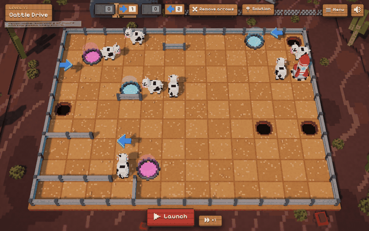
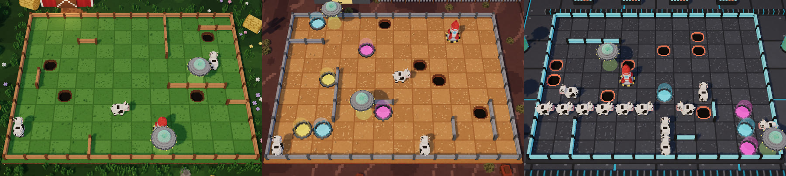

# Meuh Rocket!

A browser puzzle game in the spirit of the puzzle mode of *ChuChu Rocket!* (Dreamcast, 1999). Cows walk in straight lines across a voxel diorama. You lay down arrows to steer every cow into the escape rocket before a UFO beams one up.

40 levels in three worlds, in English or French, on desktop and on phones held sideways. No install, no account, no server.

**[Play in your browser](https://arimet.github.io/meuh-rocket/)**



## How to Play

1. Place arrows on the board. Each level gives a fixed stock of arrows per direction.
2. Press **Launch**. Cows and UFOs all move at once and follow the rules below.
3. If a cow is lost, the game shows what happened, rewinds the board and hands it back to you.

A level earns 3 stars when the first launch wins, 2 within three launches and 1 after that. The **Solution** button places a working answer, and the level then earns no star.

| Action | Mouse or touch | Keyboard |
| --- | --- | --- |
| Place an arrow | Click a tile, then a direction | Hover a tile, press an arrow key |
| Remove an arrow | Click it | Hover it, press Backspace or Delete |
| Fast-forward the run | **×1** button (×2, ×4) | F |

## Rules

- Cows and UFOs move from tile to tile at a constant speed. UFOs are slower.
- At the centre of a tile, an arrow sets the direction. Then, if a wall blocks the way, the creature turns right, else left, else back.
- A cow that reaches a rocket is saved. A cow that falls in a hole or meets a UFO is lost, and so is the level.
- A UFO that enters a rocket loses the level too. A UFO that falls in a hole disappears.
- UFOs follow arrows and take teleporters, like cows.
- Teleporters come in pairs: whatever enters one comes out of its twin, heading the same way. Arrows cannot go on a teleporter.

## Three Worlds



| World | Levels | What it adds |
| --- | --- | --- |
| 1. The Farm | 1 to 10 | The tutorial: arrows, walls, holes, then UFOs |
| 2. Roswell, 1947 | 11 to 20 | Teleporters, in coloured pairs |
| 3. The Mothership | 21 to 40 | No new rule: up to 12 cows, 3 UFOs and 6 arrows per board |

Worlds open in order. From level 4 on, every board has a single answer or close to it: two at most.

## Run It Locally

You need Node.js 22 or later.

```bash
npm install
npm run dev
```

| Command | What it does |
| --- | --- |
| `npm run dev` | Starts the game on http://localhost:5173 |
| `npm test` | Runs the simulation, solver, level and UI tests |
| `npm run build` | Type-checks and builds the static site in `dist/` |
| `npm run levels` | Prints each level's difficulty: minimum arrows, number of answers |

URL options: `?fps` shows a frame counter, and `?quality=high` or `?quality=low` forces a renderer tier. In development, `?level=12` opens any level, and `gallery.html` shows every voxel model.

## Make a Level

Each level is one JSON file in `src/levels/`. Ids 1 to 10 belong to world 1, 11 to 20 to world 2 and 21 onward to world 3.

```json
{
  "id": 1,
  "name": { "fr": "Premier pas", "en": "First Steps" },
  "idea": { "fr": "Pose une flèche pour guider la vache jusqu’à la fusée.", "en": "Place an arrow to guide the cow to the rocket." },
  "grid": ["+-+-+-+", "|. . .|", "+ +-+ +", "|R . O|", "+-+-+-+"],
  "cows": [[0, 0, "E"]],
  "ufos": [],
  "stock": { "N": 0, "E": 0, "S": 0, "W": 1 },
  "solution": [[2, 0, "W"]]
}
```

- `grid` has `2H+1` rows of `2W+1` characters. Odd rows and columns are tiles: `.` empty, `O` hole, `R` rocket, a digit `1` to `9` for a teleporter (each digit used twice).
- The characters between tiles are walls: `-` and `|`. The border must be walled.
- Cows and UFOs start at `[x, y, direction]`, with `y` going down.
- `idea` is the hint shown when the level opens.

Then run `npm run levels -- --write`. It solves every level and stores one answer in `solution`, which the **Solution** button uses. The tests check that each level is solvable within its stock, fails without arrows, and that its stored answer wins.

## How It Works

| Folder | Role |
| --- | --- |
| `src/sim` | Level parser, deterministic simulation at 16 ticks per second, solver. No DOM, no Three.js. |
| `src/game` | Plays a precomputed run, shows the failure, rewinds it, fast-forwards it. |
| `src/render` | Three.js scene. Every model is built from voxels in code: there is no asset file. |
| `src/ui` | Screens, arrow picker, saved progress, translations. |
| `src/levels` | One JSON file per level, plus the list of worlds. |

The game computes the whole run the moment you press Launch, then the renderer plays it back. Rewinding and fast-forwarding only move through that recording.

The solver tries arrow placements one at a time. A new arrow only matters on a tile some creature reaches before the run fails. It also has to sit on the path of a creature involved in that failure. A test checks this pruning against a brute-force search on 150 random boards.

## Translations

Interface texts live in `src/ui/i18n.ts`, one dictionary per language. TypeScript refuses a dictionary with a missing key. Level and world names carry one entry per language.

The game picks French for French browsers and English otherwise. The button in the top corner of the title and level screens switches language and remembers the choice.

## Deploy

`.github/workflows/deploy.yml` tests, builds and publishes `dist/` to GitHub Pages on every push to `main`. In the repository settings, set Pages to *Source: GitHub Actions*. The build uses relative URLs, so it works under any path.

## Contributing

Issues and pull requests are welcome, new levels included. Run `npm test` before opening a pull request.

## Credits

Inspired by *ChuChu Rocket!* by Sonic Team (Sega, 1999). This project is not affiliated with Sega. Boards, models and sounds are original. Sounds are synthesised with Web Audio. The font is [Pixelify Sans](https://fonts.google.com/specimen/Pixelify+Sans) (SIL Open Font License).

## License

[MIT](LICENSE)
